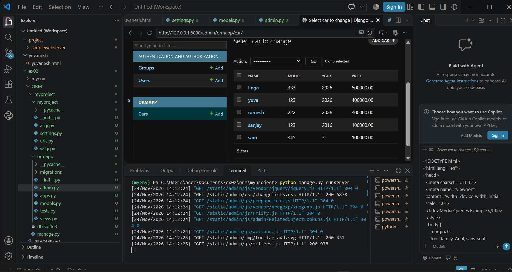

# Ex02 Django ORM Web Application
## Date:24/11/2026

## AIM
To develop a Django application to store and retrieve data from a Car Inventory Database using Object Relational Mapping(ORM).

## ENTITY RELATIONSHIP DIAGRAM


## DESIGN STEPS

### STEP 1:
Clone the problem from GitHub

### STEP 2:
Create a new app in Django project

### STEP 3:
Enter the code for admin.py and models.py

### STEP 4:
Execute Django admin and create details for 10 books

## PROGRAM
```
models.py
from django.db import models
from django.db import models
from django.contrib import admin
# Create your models here.
class  Car(models.Model):
    name = models.CharField(max_length=100)
    model = models.CharField(max_length=100)
    year = models.IntegerField()
    price = models.DecimalField(max_digits=10, decimal_places=2)
class CarAdmin(admin.ModelAdmin):
    list_display = ('name', 'model', 'year', 'price')

admin.py
from django.contrib import admin
from django.contrib import admin
from .models import Car,CarAdmin

```


## OUTPUT



## RESULT
Thus the program for creating car inventory database database using ORM hass been executed successfully
